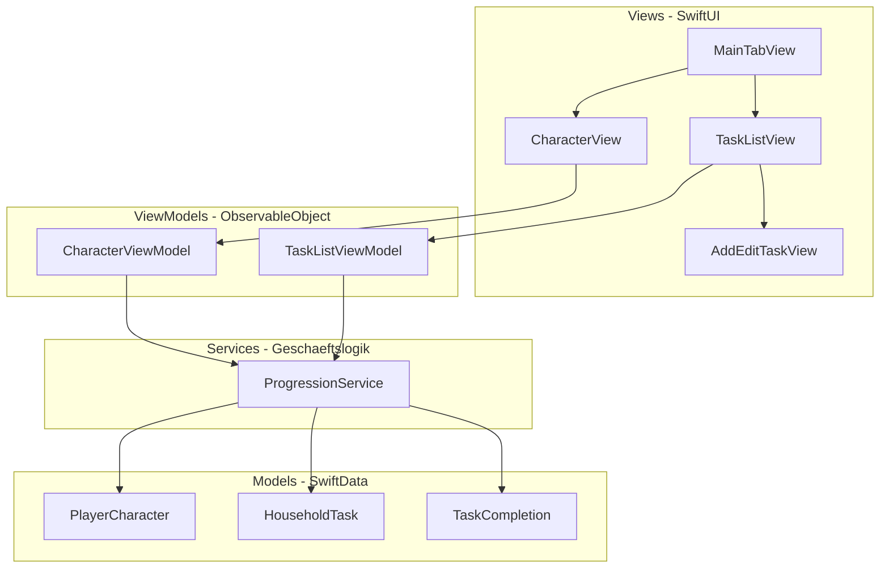

# Loot & Laundry -- MVP Implementierungsplan

## Ist-Zustand

- Frisches Xcode-SwiftUI-Template (2 Dateien: `Loot_LaundryApp.swift`, `ContentView.swift`)
- 5 Charakter-Grafiken bereits als Assets hinterlegt: `1_der_novize` bis `5_der_meister`
- Keine Geschaeftslogik, kein Datenmodell, keine Tests vorhanden

## Designentscheidung: Evolutionssystem (Vorschlag)

Da das Evolutionssystem noch offen ist, hier der Vorschlag: **EXP-Schwellenwert-System mit aufgabenbasierter EXP-Vergabe**.

| Stufe | Name | EXP-Schwelle | Asset |
|-------|------|-------------|-------|
| 1 | Der Novize | 0 | `1_der_novize` |
| 2 | Der Gelehrte | 100 | `2_der_gelehrte` |
| 3 | Der Magier | 300 | `3_der_magier` |
| 4 | Der Arkanist | 600 | `4_der_arkanist` |
| 5 | Der Meister | 1000 | `5_der_meister` |

EXP-Vergabe pro Aufgabe nach Schwierigkeitsgrad:
- **Leicht** (z.B. Muell rausbringen): 5 EXP
- **Mittel** (z.B. Geschirrspueler ausraeumen): 10 EXP
- **Schwer** (z.B. Bad putzen): 20 EXP
- **Bonus**: Streak-Multiplikator (x1.5 bei 3+ Tagen in Folge) als optionale Erweiterung

## Architektur

MVVM-Architektur mit klarer Trennung in 4 Schichten:



## Ordnerstruktur (neu)

```
Loot&Laundry/
  Models/
    PlayerCharacter.swift
    HouseholdTask.swift
    TaskCompletion.swift
    CharacterEvolution.swift     (Enum mit Stufen + Schwellenwerten)
  ViewModels/
    CharacterViewModel.swift
    TaskListViewModel.swift
  Views/
    MainTabView.swift
    CharacterView.swift
    TaskListView.swift
    AddEditTaskView.swift
  Services/
    ProgressionService.swift     (EXP-Berechnung, Evolutions-Logik)
    SeedDataService.swift        (Vordefinierte Aufgaben)
```

## Datenmodell (SwiftData)

### PlayerCharacter
- `id: UUID`
- `name: String`
- `totalEXP: Int`
- `createdAt: Date`
- `currentEvolution: CharacterEvolution` (computed aus totalEXP)

### HouseholdTask
- `id: UUID`
- `title: String`
- `difficulty: TaskDifficulty` (enum: easy/medium/hard)
- `isRecurring: Bool`
- `recurrenceRule: RecurrenceRule?` (enum: daily/weekly/custom)
- `isPredefined: Bool`
- `completions: [TaskCompletion]` (Relationship)

### TaskCompletion
- `id: UUID`
- `completedAt: Date`
- `expEarned: Int`
- `task: HouseholdTask` (Relationship)

## Implementierungsreihenfolge

### Phase 1: Datenmodell + Kernlogik (TDD)
Zuerst die testbare Geschaeftslogik **ohne UI**:
1. `CharacterEvolution` Enum mit Stufen und Schwellenwerten
2. `ProgressionService` mit EXP-Berechnung und Evolutions-Ermittlung
3. SwiftData-Models (`PlayerCharacter`, `HouseholdTask`, `TaskCompletion`)
4. Unit-Tests fuer `ProgressionService` (EXP-Vergabe, Stufenaufstieg, Grenzwerte)

### Phase 2: Aufgabenverwaltung (UI)
5. `TaskListView` -- Liste aller Aufgaben, gruppiert nach Status (offen/erledigt heute)
6. `AddEditTaskView` -- Formular fuer neue Aufgaben (Titel, Schwierigkeit, Wiederholung)
7. `TaskListViewModel` -- Verbindung SwiftData zu Views
8. `SeedDataService` -- Vordefinierte Beispiel-Aufgaben beim ersten Start

### Phase 3: Charakter-Screen (UI)
9. `CharacterView` -- Charakter-Bild (Evolution), EXP-Balken, Statistiken
10. `CharacterViewModel` -- Charakter-Daten und Fortschritt
11. Animations-Effekt bei Stufenaufstieg

### Phase 4: Navigation + Polish
12. `MainTabView` -- Tab-Navigation (Charakter / Aufgaben)
13. App-Entry anpassen (`Loot_LaundryApp.swift` mit SwiftData ModelContainer)
14. UI-Polish: Farben, Typografie, RPG-Feeling

## Offene Punkte / Entscheidungen

Die folgenden Punkte muessen nicht sofort geklaert werden, sollten aber im Verlauf adressiert werden:

- **Streak-Mechanik**: Soll ein Streak-Bonus (z.B. x1.5 EXP bei 3+ Tagen) schon im MVP rein oder erst spaeter?
- **Wiederkehrende Aufgaben -- Reset-Logik**: Wann gilt eine taegliche Aufgabe als "faellig"? Fester Zeitpunkt (Mitternacht) oder rollierend (24h nach letzter Erledigung)?
- **Charakter-Name**: Kann der Spieler seinen Charakter benennen, oder hat er einen festen Namen?
- **Onboarding**: Soll es beim ersten Start einen kurzen Einrichtungs-Flow geben (Name waehlen, erste Aufgaben anlegen)?
- **Bilder 2x/3x**: Die Charakter-Assets liegen nur in 1x vor -- fuer scharfe Darstellung auf Retina-Geraeten sollten 2x/3x-Varianten erstellt werden
- **EXP-Balancing**: Die vorgeschlagenen Schwellenwerte (100/300/600/1000) sind ein Startwert -- nach ersten Tests ggf. anpassen
